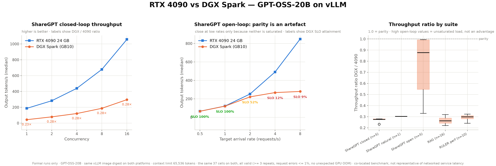

**English** | [繁體中文](README.zh-TW.md)

# GPT-OSS local serving benchmarks

A shared benchmark harness measuring GPT-OSS throughput, latency, and SLO attainment on **RTX 4090 / WSL2 and DGX Spark**, with public per-test-cell CSVs, analysis code, figures, and Traditional Chinese reports.

The project asks how the platforms serve the same workloads and how much concurrency a single DGX Spark sustains under specified latency requirements. Measurements are complete; the data snapshot runs through **2026-08-18**.

| Platform | Models and measurement scope | Published per-cell summary |
|---|---|---|
| RTX 4090 24 GB / WSL2 | GPT-OSS-20B; llama.cpp and vLLM | 124 cells: 116 valid, 8 invalid |
| DGX Spark (GB10 / ARM64) | GPT-OSS-20B and 120B; valid measurements use vLLM | 83 cells: 81 valid, 2 invalid |

## Key findings

| Finding | Conditions and interpretation |
|---|---|
| DGX throughput is about **0.28×** the 4090's; P95 TTFT is about **3.01×** | GPT-OSS-20B, vLLM on both platforms; medians of per-cell ratios across 32 of 37 shared cells after excluding 5 open-loop cells. Throughput ratios range from 0.221 to 0.323 |
| Similar throughput at low arrival rates does not establish equal saturation capacity | ShareGPT open-loop: throughput ratio is about 0.99 at 0.5 req/s and 0.33 at 8 req/s, where DGX SLO attainment falls to 9.5% |
| Highest tested passing concurrency on DGX is **C8 for 20B**, **C2 for 120B** | ShareGPT closed-loop, fixed 128-token output; TTFT ≤1000 ms and ITL ≤50 ms, with ≥95% of requests meeting both requirements |



The cross-platform comparison uses the same 37 test cells, vLLM image digest, and datasets. All 15 shared prepared files have matching SHA256 hashes. These results apply to the tested configurations and workloads, rather than establishing a hardware ranking for all models or deployments. See the [cross-platform and model-capacity analysis](dgx-spark-cuda/analysis/README.md) and [dataset manifest](docs/DATASET_MANIFEST.md).

## Read the published results

No GPU or raw conversation data is required:

| Question | Entry point |
|---|---|
| Platform differences and 20B / 120B capacity | [DGX analysis and figures](dgx-spark-cuda/analysis/README.md) |
| Complete RTX 4090 methodology and results | [Formal report](rtx4090-wsl2/reports/dataset_benchmark_complete_report_zh-TW.md) |
| Per-cell numbers and validity | [4090 CSV](rtx4090-wsl2/analysis/output/dataset-cell-summary-rtx4090.csv), [DGX CSV](dgx-spark-cuda/analysis/dataset-cell-summary.csv), [37-cell comparison CSV](dgx-spark-cuda/analysis/cross-platform-comparison.csv) |
| Metrics, validity rules, and comparison boundaries | [RESULTS](docs/RESULTS.md) |

Both platform summaries contain 109 columns, retaining invalid cells, valid-repeat counts, failure reasons, and statistical intervals. `valid` means a measurement passes the validity rules; it does not mean the latency SLO is satisfied.

## Regenerate the analysis

Run these commands from the repository root. The two DGX analysis figures can be redrawn from published CSVs without raw results or a GPU:

```bash
python -m venv .venv
source .venv/bin/activate
python -m pip install pandas matplotlib
python dgx-spark-cuda/analysis/plot_cross_platform.py
python dgx-spark-cuda/analysis/plot_model_capacity.py
```

Rebuilding CSVs from raw results requires the original data locally; that data is not distributed with this repository:

```bash
python -m pip install -r scripts/dataset-tests/requirements.txt
python dgx-spark-cuda/analysis/build_cross_platform.py   --dgx-results /path/to/dgx-spark-cuda/results   --rtx4090-results /path/to/llm-serving-benchmark/results
```

Other analysis entry points and outputs are documented in [RESULTS](docs/RESULTS.md).

## Rerun the measurements

Use Python 3.12 and WSL2 / Linux, plus models, a GPU serving environment, AIPerf, and llama-benchy. Install dependencies following the [reproduction guide](docs/REPRODUCIBILITY.md) and [external tool versions](docs/EXTERNAL_TOOLS.md), then check the shared harness:

```bash
python -m pip install -r scripts/dataset-tests/requirements.txt
python -m unittest discover -s scripts/dataset-tests -p 'test_*.py'
python scripts/dataset-tests/benchmark_matrix.py
```

Next, follow the [dataset campaign guide](scripts/dataset-tests/README.md) for data preparation, preflight, and formal runs; DGX configuration is covered in the [platform guide](dgx-spark-cuda/README.md). A complete campaign takes tens of GPU hours. The optional benchlab wrappers require a separate project; see [setup instructions](scripts/README.md#可選的-benchlab-cli).

Measurements use third-party AIPerf and llama-benchy. This project supplies test configurations, orchestration, validity checks, and analysis. Workloads cover startup, context / concurrency scaling, prefix cache, ShareGPT, SQuAD / HotpotQA RAG, and RULER.

## Repository layout

```text
.
├── README.md / README.zh-TW.md
├── .github/                 # Syntax CI, issue and PR templates
├── docs/                    # Sources, validity, versions, reproduction, publishing
├── scripts/
│   ├── dataset-tests/       # Shared campaign harness
│   └── benchlab.sh / .ps1   # Optional external CLI wrappers
├── rtx4090-wsl2/
│   ├── analysis/            # CSVs, analysis code, and figures
│   ├── reports/             # Three formal Traditional Chinese reports
│   └── scripts/             # llama.cpp / vLLM micro-benchmarks and environment checks
├── dgx-spark-cuda/
│   ├── analysis/            # Platform, cross-platform, and model-capacity analysis
│   ├── campaigns/           # Campaign metadata and validation
│   ├── docs/                # DGX platform documentation
│   └── scripts/             # Platform scripts and vLLM launchers
├── results/                 # Public documentation; raw results remain local
│   ├── README.md
│   └── generated-summary.md # Legacy summary
├── CONTRIBUTING.md
└── LICENSE
```

Top-level READMEs are bilingual; other documents are primarily in Traditional Chinese. See the [full structure guide](docs/REPOSITORY_STRUCTURE.md). The companion project [**dgx-spark-serving**](https://github.com/chenboju/dgx-spark-serving) contains single-node and two-node vLLM / TensorRT-LLM deployment records for DGX.

## Comparison boundaries and data publication

- Cross-platform results use single-node vLLM with the load generator and server on the same machine. They do not establish remote network latency, two-node scaling, or TensorRT-LLM performance.
- RTX 4090 llama.cpp / vLLM comparisons include GGUF versus Hugging Face packaging differences, so the engine is not the only variable. DGX has no valid llama.cpp measurements.
- RAG measures inference with assembled context, excluding retrieval and reranking. Older synthetic baselines and formal dataset campaigns must not be averaged together.
- GPU memory usage was unavailable in the GB10 telemetry collected here; missing values are not zero. Power readings cover different power domains, so no cross-platform energy-efficiency conclusion is made.
- Raw results contain ShareGPT conversations and third-party personal data. They remain local and are excluded from Git and releases. Public CSVs, figures, and reports retain aggregated results and validity metadata; recalculation from raw runs still requires the original data.

See [DATASETS](docs/DATASETS.md) and [PUBLISHING](docs/PUBLISHING.md) for sources and publication rationale. Original content uses the [MIT licence](LICENSE); AIPerf uses Apache-2.0, llama-benchy uses MIT, and models and datasets retain their respective licences.
