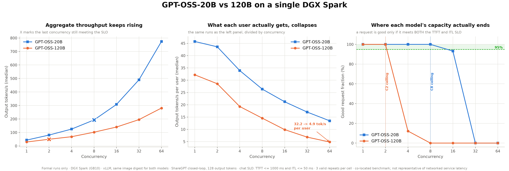

# DGX Spark 分析輸出

由原始 campaign 產物彙總而成的衍生資料。原始執行產物不隨 repository 散布
（原因見 [`../README.md`](../README.md#未包含的內容)），本目錄是可公開的替代品。

## 檔案

| 檔案 | 內容 |
|---|---|
| `dataset-cell-summary.csv` | 四個 DGX campaign 的逐 cell 彙總，83 列 × 109 欄 |
| `cross-platform-comparison.csv` | RTX 4090 vs DGX Spark，37 個共同 cell |
| `concurrency-scaling.csv` | 併發擴展，70 列 |
| `vllm-stress-summary.csv` | 壓力測試格，35 列 |
| `figures/01-cross-platform-throughput.png`／`.svg` | 4090 vs DGX 三面板對比圖 |
| `figures/02-model-capacity.png`／`.svg` | DGX 上 20B vs 120B 的容量三面板圖 |
| `build_cross_platform.py` | 由原始 results 重建上述 CSV |
| `plot_cross_platform.py` | 重建圖 01 |
| `plot_model_capacity.py` | 重建圖 02 |

`dataset-cell-summary.csv` 每列都帶有效性後設資料——`status`、`failure_reason`、
`valid_repeats`、`invalid_repeats`、`oom_repeats`、`request_count`、`p99_eligible`——
以及每個指標的 median／mean／CI95 上下界。讀者不需要原始檔就能自行套用
[`../../docs/RESULTS.md`](../../docs/RESULTS.md) 的有效性規則。

83 列中 **81 valid、2 invalid**。兩個 invalid 都是 prefix cache 關閉的格子，
皆因 valid repeat 不足 3 個而未計入，刻意保留而非刪除：

| Campaign | Cell | valid repeats | OOM |
|---|---|---:|---:|
| `formal-split-65k-20260816-dgx` | `prefix-b004k-off-c01` | 2 | 0 |
| `formal-stress-65k-20260817-dgx` | `prefix-b004k-off-c16` | 0 | 0 |

兩格的 `oom_repeats` 都是 0，代表不是記憶體不足，而是重複次數未達門檻。

## 重建方式

原始 results 需在本機備妥：

```bash
python build_cross_platform.py \
  --dgx-results     /path/to/dgx-spark-cuda/results \
  --rtx4090-results /path/to/llm-serving-benchmark/results
python plot_cross_platform.py
python plot_model_capacity.py
```

`build_cross_platform.py` 對每個 campaign 分開呼叫
[`../../scripts/dataset-tests/analyze_dataset_results.py`](../../scripts/dataset-tests/analyze_dataset_results.py)。
不合併呼叫是必要的：該腳本會對 `(backend, cell_id)` 去重並保留 mtime 最新者，
而 `formal-split`、`formal-stress`、`formal-20b-s064` 三批的 cell_id 有重疊，
一次傳入會讓不同 campaign 的格子互相覆蓋。

## 結果

### 吞吐：DGX Spark 約為 RTX 4090 的 0.28×


37 個共同 cell，兩邊皆 vLLM、同一個 image digest、同一份資料集。

| 範圍 | n | 吞吐比中位數 | 範圍 |
|---|---:|---:|---|
| 全部 | 37 | 0.282 | 0.221 – 0.994 |
| 排除 open-loop | 32 | 0.279 | 0.221 – 0.323 |

closed-loop 的比值極穩定：C1 為 0.23，C2 至 C16 都是 0.28。
P95 TTFT 方面，排除 open-loop 後中位數為 4090 的 3.01 倍；各 suite 的中位數落在
2.87（RULER）到 3.30（ShareGPT natural）之間，逐格範圍 2.52–8.00 倍。

### open-loop 的「接近平手」是負載未飽和

這是本次對比最容易誤讀的一組數字。open-loop 依固定到達率送請求，
低速率下兩平台的吞吐都等於到達率，看起來幾乎相同：

| 目標到達率 | 4090 tok/s | DGX tok/s | 比值 | DGX SLO 達成率 |
|---:|---:|---:|---:|---:|
| 0.5 | 65.6 | 65.1 | 0.99 | 100% |
| 1 | 121.6 | 120.7 | 0.99 | 100% |
| 2 | 252.6 | 221.5 | 0.88 | **51.6%** |
| 4 | 491.4 | 267.9 | 0.55 | **12.1%** |
| 8 | 848.6 | 279.9 | 0.33 | **9.5%** |

吞吐比從 0.99 掉到 0.33，同時 SLO 達成率從 100% 崩到 9.5%——DGX 在 r=2 就已經
跟不上，只是吞吐數字還沒反映出來。**只看 tokens/s 會得到「兩者相當」的錯誤結論**；
必須同時看 SLO 達成率。這也是 closed-loop 才適合用來宣稱容量的原因。

### GPU 記憶體遙測在 GB10 上不可得

`dataset-cell-summary.csv` 的 `gpu_memory_peak_gib_*` 欄位在 DGX 側**全為空值**。

原因不是測試失誤：GB10 是 unified memory，pynvml 的 telemetry payload 裡
**沒有 `nvidia_memory_used` 欄位**（`nvidia-smi` 對應欄位顯示 `Not Supported`）。
4090 側同樣的 10 欄 payload 則有該欄位。已抽樣全部 campaign 確認一致。

因此本專案**無法**提出 DGX Spark 的記憶體佔用或 KV cache 容量數據。
不要把空值解讀成「用量為零」。

### 功耗數字不可跨平台比較

兩平台都有 `nvidia_power_usage`，中位數分別是 4090 約 341 W、DGX 約 44 W，
換算能耗約 0.52 J/token 比值。**但這個比較無效，不應引用。**

4090 是獨立顯示卡，讀數涵蓋整張卡；GB10 是 CPU 與 GPU 共封裝、共記憶體的 SoC，
`nvidia_power_usage` 只涵蓋其中一部分電源域，且 `nvidia-smi` 的功率上限顯示為
`N/A`。兩者量的不是同一個東西。本專案沒有插座功率計，因此不發表
tokens/Wh 或跨平台能源效率結論；上述數字僅作為原始遙測保留。

### 20B vs 120B：單台 DGX Spark 的容量上限



同平台、同 backend、同一個 vLLM image digest，只有模型規模不同，
因此可解讀為**容量**而非引擎效能。ShareGPT closed-loop，輸出固定 128 tokens，
`chat` SLO profile 為 **TTFT ≤ 1000 ms 且 ITL ≤ 50 ms**，兩者都達標才算 good request。

| Concurrency | 20B tok/s | 120B tok/s | 120B / 20B | 20B SLO | 120B SLO |
|---:|---:|---:|---:|---:|---:|
| 1 | 43.5 | 29.5 | 0.68 | 100% | 100% |
| 2 | 81.0 | 49.9 | 0.62 | 100% | 100% |
| 4 | 125.0 | 68.7 | 0.55 | 100% | **12.2%** |
| 8 | 192.7 | 102.1 | 0.53 | 100% | 0% |
| 16 | 307.8 | 140.3 | 0.46 | 93.2% | 0% |
| 32 | 490.3 | 195.3 | 0.40 | 0% | 0% |
| 64 | 774.0 | 280.9 | 0.36 | 0% | 0% |

**在 95% good request 門檻下的併發上限：20B 是 C8，120B 是 C2。**

這張圖的重點是三個面板必須一起看。只看左邊那張，兩個模型的總吞吐**到 C64 都還在漲**——
120B 從 29.5 漲到 280.9 tok/s，看起來擴展得很好。但：

- **中間面板**：每使用者實得吞吐一路崩，120B 從 32.2 掉到 4.9 tok/s。
  總吞吐的成長全部來自「同時服務更多人」，不是「服務得更快」。
- **右邊面板**：120B 在 C4 就掉到 12.2%，C8 之後歸零。

120B 在 C4 崩掉是因為 **TTFT 與 ITL 同時破線**——TTFT 1026 ms（門檻 1000）、
ITL 53.6 ms（門檻 50）。兩項在同一格一起失守，代表這不是單一瓶頸，
而是該併發下整體已經吃不消。

20B 在 C16 的 93.2% 值得注意：它沒有崩，只是**差一點**達不到 95% 門檻。
真正的斷崖在 C32（TTFT 1345 ms）。

實務上的意思是：這台機器跑 120B 只能服務約 2 個並行使用者；要更高併發，
得放寬 SLO、縮短 context，或改用雙節點。

## 解讀邊界

- 這是 **co-located benchmark**：負載產生器與伺服器同機，不代表網路服務延遲。
- 兩平台比較僅限 `formal-split-65k` 的 37 個 cell；其餘 campaign 的 cell 集合不同。
- llama.cpp 在 DGX 側只有 dry-run，**沒有** valid 資料，因此無法做 DGX 上的
  vLLM vs llama.cpp 對比。
- 4090 側的數據取自 `formal-split-65k-20260814` 的 vLLM 分支（37 cells，全部 valid）。
