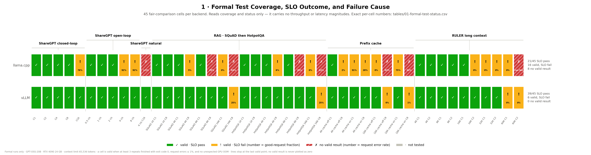
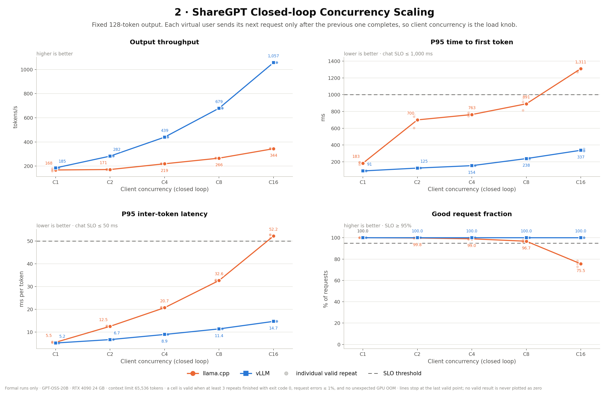
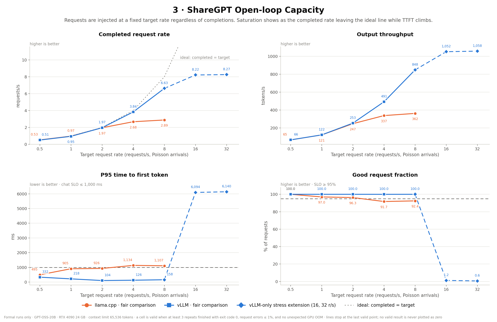
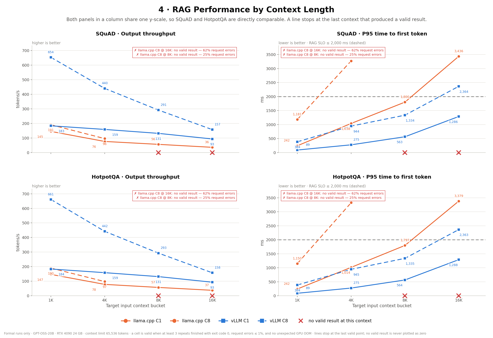
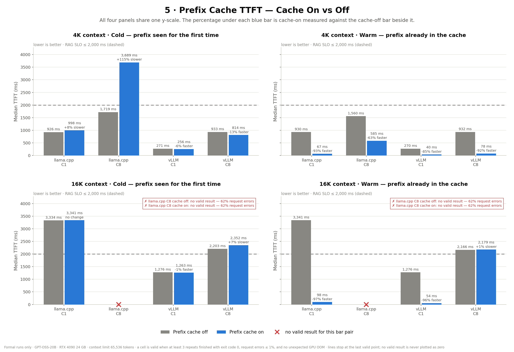
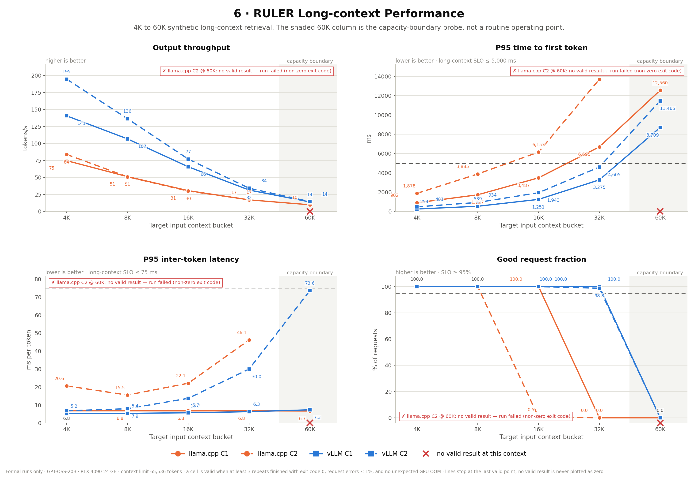
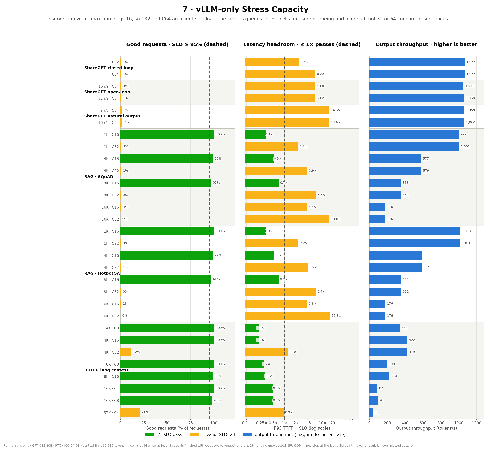
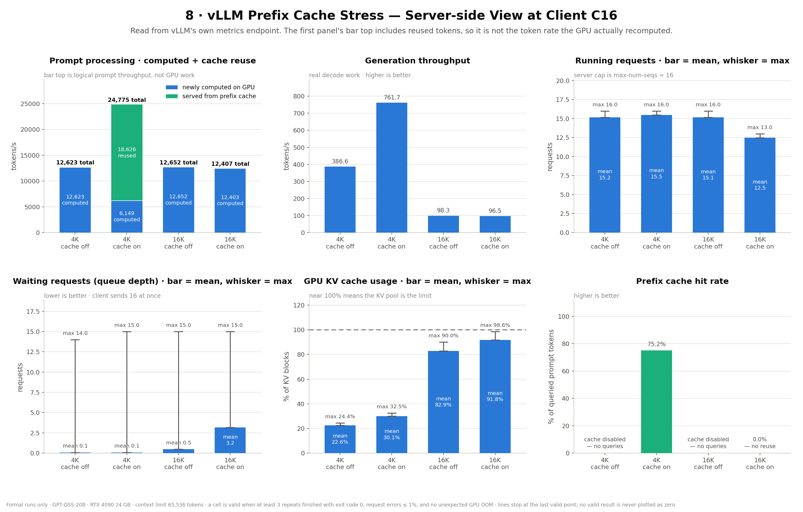

# GPT-OSS-20B 資料集測試與圖表說明書

更新日期：2026-08-17  
測試對象：llama.cpp、vLLM  
硬體：NVIDIA GeForce RTX 4090 24 GB  
模型：GPT-OSS-20B  
Context 上限：65,536 tokens

## 1. 文件目的

本文件說明：

1. 原始資料集、測試用資料與正式測試結果放在哪裡。
2. 每個資料夾與主要檔案的用途。
3. `valid`、SLO fail、request error、run failed 等狀態如何判定。
4. 圖一至圖八分別表示什麼，以及閱讀時應注意哪些限制。
5. 如何用正式結果重新產生圖表。

本次圖表只讀取正式測試資料夾，不會混入舊版 synthetic、pilot、interactive 或臨時測試結果。

## 2. 重要名詞

| 名詞 | 意義 |
|---|---|
| `C1`、`C8`、`C16` | Client concurrency，同時由客戶端維持的請求數。 |
| `C32`、`C64` | 客戶端壓力為 32 或 64；vLLM server 仍受 `max-num-seqs=16` 限制，多出的請求會排隊。 |
| `1K`、`4K`、`8K`、`16K` | 目標輸入 context bucket，實際 token 數依資料集允許小幅差異。 |
| `r/s` | Target request rate，open-loop 每秒送出的目標請求數。 |
| TTFT | Time to first token，第一個輸出 token 的等待時間；越低越好。 |
| ITL | Inter-token latency，相鄰輸出 token 的延遲；越低越好。 |
| Output throughput | 每秒產生的輸出 token；越高越好。 |
| Good request | 同時符合該測試 SLO 且沒有 request error 的請求。 |
| Prefix cache hit rate | 被 Prefix Cache 重用的 queried prompt tokens 比例。 |

## 3. 資料位置

### 3.1 原始與準備後的資料集

```text
datasets/
├── raw/          # 從上游取得的原始資料
├── prepared/     # 固定 seed=42、可直接提供給 AIPerf 的 JSONL
└── manifests/    # 來源、revision、SHA256、tokenizer、筆數與 token 分布
```

主要資料位置：

| 類型 | 路徑 | 說明 |
|---|---|---|
| 原始資料 | `datasets/raw/` | ShareGPT、SQuAD、HotpotQA 與 RULER 上游資料。 |
| ShareGPT 測試檔 | `datasets/prepared/sharegpt/` | Fixed 128-token output 與 natural output length 版本。 |
| RAG 測試檔 | `datasets/prepared/rag/` | SQuAD、HotpotQA 的 1K／4K／8K／16K context。 |
| Prefix Cache 測試檔 | `datasets/prepared/prefix/` | 4K／16K、cache off／on。 |
| RULER 測試檔 | `datasets/prepared/ruler/` | 4K／8K／16K／32K／60K。 |
| 資料 manifest | `datasets/manifests/` | 每個 prepared JSONL 的來源與完整性紀錄。 |

每個 prepared 資料通常有兩個檔案：

- `*.jsonl`：AIPerf 實際讀取的輸入。
- `*.index.jsonl`：sample ID、實際 token 數、bucket、prefix group、cold/warm role 等旁路資訊。

### 3.2 正式測試結果

| Backend | 類型 | 正式結果路徑 | Cells | Valid | Invalid |
|---|---|---|---:|---:|---:|
| llama.cpp | 公平比較：ShareGPT、RAG、RULER | `results/llama-cpp/dataset/formal-split-65k-20260814/` | 37 | 31 | 6 |
| llama.cpp | 公平比較：Prefix Cache | `results/llama-cpp/dataset/formal-prefix-65k-20260816/` | 8 | 6 | 2 |
| vLLM | 公平比較：ShareGPT、RAG、RULER | `results/vllm/dataset/formal-split-65k-20260814/` | 37 | 37 | 0 |
| vLLM | Prefix 公平比較＋Prefix 壓力測試 | `results/vllm/dataset/formal-prefix-65k-20260816/` | 12 | 12 | 0 |
| vLLM | 其他進階壓力測試 | `results/vllm/dataset/formal-vllm-stress-65k-20260816/` | 30 | 30 | 0 |

彙總後：

| 範圍 | Cells | Valid | SLO pass |
|---|---:|---:|---:|
| llama.cpp 公平比較 | 45 | 37 | 21 |
| vLLM 公平比較 | 45 | 45 | 39 |
| vLLM 進階壓力測試 | 34 | 34 | 14 |

`formal-prefix-65k-20260816` 中的 vLLM 結果同時包含：

- 8 個 `scope=comparison` 公平比較 cells。
- 4 個 `scope=vllm_stress`、client C16 的 Prefix Cache 壓力 cells。

### 3.3 圖片與產圖程式

| 內容 | 路徑 |
|---|---|
| 圖一至圖八 | `analysis/dataset-figures/` |
| Python 產圖程式 | `analysis/plot_dataset_figures.py` |
| 測試矩陣與 SLO 設定 | `scripts/dataset-tests/benchmark-config.json` |
| 測試框架說明 | `scripts/dataset-tests/README.md` |

每張圖同時輸出：

- PNG：適合 GitHub README、報告與一般預覽。
- SVG：適合簡報、論文或後續無損縮放。

## 4. Cell 資料夾結構

一個測試 cell 代表一組固定條件，例如：

```text
rag-squad-b016k-c08
```

代表 SQuAD RAG、16K context、client concurrency 8。

常見命名片段：

| 片段 | 意義 |
|---|---|
| `b004k` | 4K context bucket。 |
| `c08` | Client concurrency 8。 |
| `r16` | Target request rate 16 requests/s。 |
| `off`／`on` | Prefix Cache 關閉／開啟。 |

Cell 內主要結構：

```text
<cell-id>/
├── cell.json
├── validation.json
├── repeat-metrics.csv
├── repeat-01/
├── repeat-02/
└── repeat-03/
```

主要檔案用途：

| 檔案 | 用途 |
|---|---|
| `cell.json` | 測試條件：suite、scope、context、concurrency、request rate、cache mode、SLO profile。 |
| `validation.json` | Cell 是否取得足夠有效 repeats，以及 valid／invalid／OOM repeat 數。 |
| `repeat-metrics.csv` | 每個 repeat 的吞吐、TTFT、ITL、錯誤率、valid 狀態與 OOM 判定。 |
| `repeat-N/command.txt` | 該次執行的實際命令。 |
| `repeat-N/profile_export_aiperf.csv` | AIPerf 彙總指標。 |
| `repeat-N/profile_export.jsonl` | Per-request 詳細紀錄；Prefix cold/warm 分析使用此檔。 |
| `repeat-N/gpu_telemetry_export.jsonl` | GPU utilization、顯存與功耗等 telemetry。 |
| `repeat-N/server_metrics_export.json` | vLLM server metrics；圖八使用。llama.cpp 不一定有此檔。 |
| `repeat-N/inputs.json`、`outputs.json` | 本次請求輸入與回應紀錄。 |
| `repeat-N/logs/` | AIPerf 與 server 執行紀錄。 |
| `repeat-N/phases/` | warmup 與 profiling 階段的分開輸出。 |

## 5. Valid、SLO 與失敗原因

### 5.1 Repeat 有效條件

單次 repeat 必須同時符合：

1. Process exit code 為 0。
2. 沒有偵測到非預期 GPU OOM。
3. Request error rate 小於或等於 1%。
4. AIPerf 有產生完整的效能指標。

### 5.2 Cell 有效條件

一個 cell 至少需要 3 次有效 repeat。若前三次不穩定，測試框架可追加第 4、5 次；分析只使用有效 repeats。

`No valid result` 的意思是沒有取得足夠的有效 repeats，**不是效能為 0**。因此：

- 圖中的折線會在最後一個有效點停止。
- 不會將 invalid cell 當作 0 參與平均。
- 紅色文字會直接說明 request error 比例或 run failure。

### 5.3 SLO 門檻

所有 suite 共用：

- Good request fraction ≥ 95%。
- Request error rate ≤ 1%。

延遲門檻：

| SLO profile | P95 TTFT | P95 ITL |
|---|---:|---:|
| Chat | ≤ 1,000 ms | ≤ 50 ms/token |
| RAG | ≤ 2,000 ms | ≤ 50 ms/token |
| Long context | ≤ 5,000 ms | ≤ 75 ms/token |

`Valid · SLO fail` 表示測試資料有效，但效能沒有達到上述門檻；它不同於執行失敗。

### 5.4 目前沒有有效結果的 cells

目前 8 個無效 cells 全部屬於 llama.cpp，且沒有偵測到 GPU OOM：

| Cell | 原因 |
|---|---|
| `rag-squad-b008k-c08` | 每次 repeat 約 25% request errors。 |
| `rag-hotpotqa-b008k-c08` | 每次 repeat 約 25% request errors。 |
| `rag-squad-b016k-c08` | 每次 repeat 約 62.5% request errors。 |
| `rag-hotpotqa-b016k-c08` | 每次 repeat 約 62.5% request errors。 |
| `prefix-b016k-off-c08` | Cache off 時約 62.5% request errors。 |
| `prefix-b016k-on-c08` | Cache on 時約 62.5% request errors。 |
| `sharegpt-natural-r4-c16` | 約 1.41–1.56% request errors，超過 1% 上限。 |
| `ruler-perf-b060k-c02` | 執行失敗，沒有取得足夠的完整有效結果。 |

## 6. 共用圖例與閱讀方式

### 6.1 顏色

| 顏色 | 意義 |
|---|---|
| 橘色 | llama.cpp。 |
| 藍色 | vLLM。 |
| 綠色 | SLO pass，或 Prefix Cache 重用部分。 |
| 黃色 | 結果有效，但 SLO fail。 |
| 紅色 | 沒有有效結果，圖中會附實際原因。 |
| 灰色 | Cache off、尚未測試，或中性參考數值。 |

### 6.2 線條與符號

| 表示方式 | 意義 |
|---|---|
| 圓點 | llama.cpp。 |
| 方點 | vLLM。 |
| 實線 | 較低 concurrency 或公平比較主線。 |
| 虛線 | 較高 concurrency 或 vLLM-only stress 延伸。 |
| 水平點線／虛線 | SLO 門檻。 |
| 淡色小點 | 各個有效 repeat；主線是有效 repeats 的彙總值。 |

閱讀方向：

- Throughput、good request fraction、cache hit rate：越高越好。
- TTFT、ITL、waiting requests、TTFT/SLO ratio：越低越好。
- TTFT/SLO ratio ≤ 1 才達標。
- GPU KV cache usage 接近 100% 時，表示 KV 容量接近上限，但不能單獨判定請求是否成功。

## 7. 圖一至圖八說明

### 圖一：測試覆蓋、SLO 與失敗原因



用途：快速確認每個公平比較 cell 是否有效、是否通過 SLO，以及沒有有效結果的原因。

- 每一欄是一個測試條件。
- 上列為 llama.cpp，下列為 vLLM。
- 綠色勾號表示 valid 且 SLO pass。
- 黃色 `SLO` 表示 valid，但至少一項 SLO 未達標。
- 紅色 cell 直接顯示 request error 比例或 `RUN failed`。
- 灰色表示沒有執行該 cell。

這張圖只能回答「測試是否有效、是否達標」，不能用來比較實際吞吐差距。

### 圖二：ShareGPT Closed-loop Concurrency Scaling



用途：觀察 client concurrency 從 C1 增加到 C16 時的吞吐與延遲變化。

四個 panel：

1. Output throughput：輸出 token throughput。
2. P95 TTFT：第一 token 延遲。
3. P95 ITL：token 之間的延遲。
4. Good request fraction：符合 SLO 的請求比例。

圖中淡色小點是各 repeat，實線是有效 repeats 的彙總趨勢。Closed-loop 代表每個虛擬使用者完成前一個請求後才送下一個請求。

### 圖三：ShareGPT Open-loop Capacity



用途：檢查固定送入速率下，系統是否能跟上 target request rate。

- `target = completed` 對角線代表理想狀態。
- Completed rate 越接近對角線，代表越能消化送入負載。
- Fair 線只包含兩個 backend 都執行的共同條件。
- vLLM-only stress 虛線延伸到 16、32 requests/s。
- 若 completed rate 不再增加、TTFT 急升或 good request fraction 降低，即表示容量飽和。

### 圖四：RAG Performance by Context Length



用途：比較 SQuAD 與 HotpotQA 在不同 context 長度與 concurrency 下的吞吐、P95 TTFT。

- 上排為 SQuAD，下排為 HotpotQA。
- 左欄是 output throughput，右欄是 P95 TTFT。
- 實線為 C1，虛線為 C8。
- 紅字 `No valid result` 直接顯示 request error 比例。
- 無效位置不會被畫成 0，折線會停止在最後一個有效 context。

### 圖五：Prefix Cache TTFT — Cache On vs Off



用途：比較 Cache off 與 Cache on 對 cold／warm request TTFT 的影響。

- 灰色柱為 Cache off，藍色柱為 Cache on。
- Cold 是第一次出現的 prefix；Warm 是可重用既有 prefix 的後續請求。
- `-93% better` 表示 Cache on 的 TTFT 比 Cache off 低 93%。
- `+115% worse` 表示 Cache on 的 TTFT 反而高 115%。
- Lower is better。
- 16K llama.cpp C8 的 off／on 都有 62.5% request errors，因此只顯示原因，不畫 0 高度的有效柱。

### 圖六：RULER Long-context Performance



用途：觀察 4K 到 60K context 的長文本容量邊界。

- 實線為 C1，虛線為 C2。
- 淡藍色 60K 區域標示容量邊界測試。
- 四個 panel 分別為 output throughput、P95 TTFT、P95 ITL 與 good request fraction。
- `No valid result · run failed` 表示測試執行失敗，並非 throughput 或 good request 等於 0。

### 圖七：vLLM Stress Capacity



用途：集中呈現 vLLM-only 進階壓力 cells。

每一列是一個壓力條件，三欄分別表示：

1. Good requests：綠色達到 95%，黃色未達標。
2. P95 TTFT / SLO：小於等於 1 才達標。
3. Output throughput：輸出 token throughput。

重要限制：server 使用 `--max-num-seqs 16`。因此 C32、C64 是 client load，不表示 GPU 同時執行 32 或 64 條 sequence；它們主要測量排隊、continuous batching 與過載行為。

### 圖八：vLLM Prefix Cache Stress



用途：比較 client C16 下，4K／16K context 開啟與關閉 Prefix Cache 的 server-side 行為。

六個 panel：

1. Prompt processing：灰色是 newly computed tokens/s，綠色是 cache reuse；柱頂是兩者合計的 logical prompt throughput。
2. Generation throughput：實際 generation tokens/s。
3. Running requests：柱為時間平均，whisker 上端為 observed maximum。
4. Waiting requests：柱為平均排隊數，whisker 上端為 observed maximum。
5. GPU KV usage：柱為平均使用率，whisker 上端為 observed maximum。
6. Prefix cache hit rate：Cache off 顯示 `Disabled`；Cache on 顯示 queried prompt tokens 的命中比例。

注意：logical prompt throughput 包含 cache reuse，不能直接解讀成 GPU 實際重新計算的 token throughput。應同時閱讀 newly computed 與 cached 兩個區段。

## 8. 重新產圖

在 repository root 執行：

```powershell
python analysis\plot_dataset_figures.py
```

輸出位置：

```text
analysis/dataset-figures/
```

程式會重新讀取第 3.2 節列出的五個正式結果資料夾，並覆寫圖一至圖八的 PNG 與 SVG。

需要的 Python 套件：

- pandas
- numpy
- matplotlib
- seaborn

## 9. 發布至 GitHub 前的建議

建議保留：

- `cell.json`
- `validation.json`
- `repeat-metrics.csv`
- 經過整理的圖表 PNG／SVG
- benchmark config、產圖程式與本說明書
- redacted environment／software manifest

需先檢查或清理：

- `command.txt`、logs 中的本機絕對路徑。
- API key、環境變數、hostname、使用者名稱。
- `inputs.json`、`outputs.json` 是否包含不應公開的 prompt 或模型輸出。
- 大型 per-request JSONL、GPU telemetry 與 server metrics 是否應改放 GitHub Release。
- 上游資料集是否允許重新散布；不能公開時只提交 manifest、下載方式與 SHA256。

不要手動修改圖中的數值。若正式資料有更新，應更新結果資料後重新執行產圖程式。
